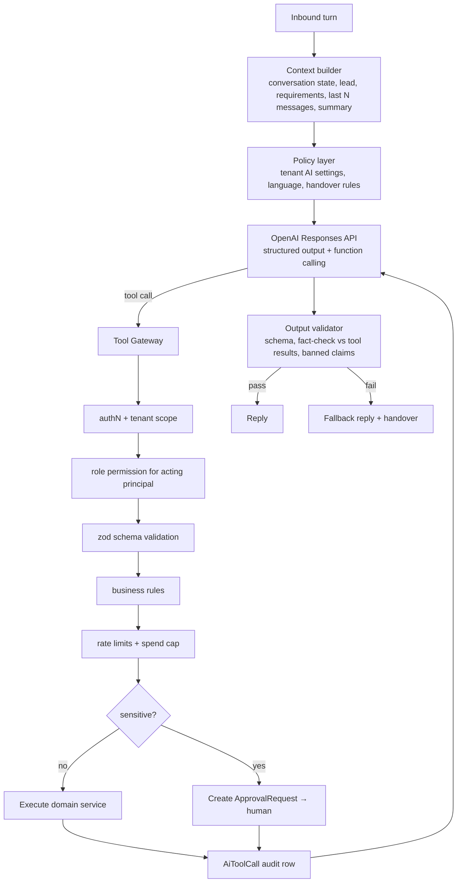

# 02 · System Architecture

**Version:** 0.1 · **Date:** 2026-11-20

---

## 1. Architectural style

A **modular monolith** (NestJS) plus **separate worker processes** sharing the same codebase, one PostgreSQL database with pgvector, Redis for queues/cache/rate limits, and S3-compatible storage. Modules communicate through in-process service interfaces and domain events (outbox → BullMQ), never by reaching into another module's tables. This keeps deployment simple for 100 agencies and leaves clean seams to extract services (e.g. messaging, AI) when measured load justifies it.

```mermaid
flowchart LR
  subgraph Clients
    WEB[Next.js web app<br/>Vercel]
    WA[WhatsApp users]
    VOICE[Phone callers]
  end

  subgraph Edge
    CDN[Vercel Edge / CDN]
    WAF[WAF + rate limit]
  end

  subgraph API["NestJS API (stateless, N replicas)"]
    AUTH[Auth & Tenancy]
    INV[Inventory]
    CRM[CRM]
    MATCH[Matching]
    CONV[Conversations]
    AIO[AI Orchestrator]
    CAL[Calendar]
    DEAL[Deals]
    FEE[Fee Calculator]
    MKT[Marketing]
    BILL[Billing]
    ADMIN[Super Admin]
    WH[Webhook Ingress]
  end

  subgraph Workers["Worker processes (BullMQ)"]
    WQ1[inbound-messages]
    WQ2[ai-replies]
    WQ3[outbound-messages]
    WQ4[imports]
    WQ5[embeddings]
    WQ6[calendar-sync]
    WQ7[documents-pdf]
    WQ8[billing-usage]
    WQ9[reminders / cron]
  end

  subgraph Data
    PG[(PostgreSQL + pgvector<br/>RLS)]
    RD[(Redis)]
    S3[(S3-compatible storage)]
  end

  subgraph External
    META[Meta WhatsApp Cloud API]
    OAI[OpenAI API]
    GCAL[Google Calendar API]
    VAPI[Voice provider + UAE telecom]
    PAY[Billing provider]
    LEADS[Meta / Google lead ads]
    MAIL[Transactional email]
    AV[Malware scanner]
  end

  WEB --> CDN --> WAF --> API
  WA --> META -->|webhook| WH
  VOICE --> VAPI -->|webhook| WH
  PAY -->|webhook| WH
  LEADS -->|webhook| WH
  API --> PG & RD & S3
  WH --> RD
  RD --> Workers
  Workers --> PG & S3
  WQ2 --> OAI
  WQ3 --> META
  WQ6 --> GCAL
  WQ5 --> OAI
  AUTH --> MAIL
  WQ4 --> AV
```



## 2. Request lifecycle and tenant context

1. Browser authenticates; API issues a short-lived **access token** (JWT, 15 min, in memory) and a rotating **refresh token** (httpOnly, Secure, SameSite=Strict cookie, stored hashed in DB). Server-side sessions table allows revocation.
2. Each request carries the active tenant (`X-Tenant-Id` or tenant encoded in the token after "switch agency"). `TenantGuard` verifies membership and status (active, not suspended).
3. A request-scoped `TenantContext` (AsyncLocalStorage) holds `tenantId`, `userId`, `role`, `permissions`.
4. **Prisma client extension** opens each transaction with `SET LOCAL app.tenant_id = '<uuid>'` and `SET LOCAL app.user_id`. PostgreSQL **RLS policies** on every tenant table enforce `tenant_id = current_setting('app.tenant_id')::uuid`. The app connects as a non-owner role without `BYPASSRLS`.
5. Defense in depth: repositories also add `where: { tenantId }`; a lint rule and tests flag raw queries missing tenant scope.
6. `PermissionGuard` checks the route's required permission (e.g. `property:write`) against the role-permission map, plus resource-level ownership rules (agents edit only their assigned leads unless granted `lead:write:any`).
7. Audit interceptor writes an `AuditLog` row for mutating requests.

Workers receive `tenantId` in every job payload and establish the same `TenantContext` before touching the DB. Super Admin operations use a separate `platform` DB role and an explicit, audited code path.

## 3. Module map

| Module | Owns tables | Publishes events | Consumes |
|---|---|---|---|
| Auth & Tenancy | User, Agency, Membership, Invitation, Session, MfaFactor, AuditLog | `member.invited`, `agency.created` | `subscription.changed` |
| Inventory | Property, PropertyMedia, Project, ImportBatch, ImportRow | `property.updated`, `property.status_changed` | `import.requested` |
| CRM | Contact, Lead, Requirement, Note, Task, Tag, ConsentRecord, Suppression | `lead.created`, `lead.assigned`, `consent.revoked` | `message.received`, `viewing.completed` |
| Matching | PropertyEmbedding, MatchResult | `matches.generated` | `property.updated`, `requirement.updated` |
| Conversations | Conversation, Message, WhatsAppAccount, MessageTemplate | `message.received`, `conversation.handover` | `ai.reply.ready` |
| AI Orchestrator | AiRun, AiToolCall, PromptVersion | `ai.reply.ready`, `ai.handover.requested` | `message.received` |
| Calendar | CalendarConnection, Viewing, Availability | `viewing.booked`, `viewing.completed` | `viewing.requested` |
| Deals | Deal, DealStageHistory, DealDocument, DocumentVersion, Commission | `deal.stage_changed` | `viewing.completed` |
| Fee Calculator | FeeSchedule, FeeRule, CalculationRecord | – | – |
| Lead Booster | Campaign, CampaignRecipient, LeadImport | `campaign.approved` | `consent.revoked` |
| Voice | VoiceCall, CallTranscript, VoiceComplianceConfig | `call.completed` | – |
| Marketing | BrandKit, GeneratedAsset, LandingPage, UtmVisit | `landing.lead_captured` | – |
| Billing | Plan, Subscription, UsageRecord, Invoice, SpendingCap | `subscription.changed`, `usage.cap_reached` | all usage events |
| Super Admin | FeatureFlag, SupportTicket, SecurityEvent | – | – |

Cross-module writes go through the owning module's service. Reliable events use a **transactional outbox** table polled into BullMQ.

## 4. Messaging pipeline (WhatsApp)

```mermaid
sequenceDiagram
  participant M as Meta Cloud API
  participant W as Webhook Ingress
  participant Q as Redis/BullMQ
  participant IN as inbound worker
  participant AI as AI Orchestrator
  participant OUT as outbound worker
  participant A as Agent (web inbox)

  M->>W: POST /webhooks/whatsapp (signed)
  W->>W: verify X-Hub-Signature-256, parse
  W->>Q: enqueue raw event (jobId = wamid) 
  W-->>M: 200 OK (< 1s)
  Q->>IN: process
  IN->>IN: dedupe by wamid, resolve tenant by phone_number_id
  IN->>IN: upsert Contact, Conversation, Message; opt-out keyword check
  alt conversation in human mode or opted out
    IN->>A: realtime notify (WebSocket/SSE)
  else AI mode
    IN->>Q: enqueue ai-reply (debounced 3–5 s per conversation)
    Q->>AI: run with tools
    AI->>AI: tool calls (tenant-scoped, audited)
    AI->>Q: enqueue outbound (or handover)
    Q->>OUT: send via Cloud API (24h window check, rate limit)
    OUT->>M: POST /messages
    M->>W: status webhooks (sent/delivered/read/failed)
  end
```

- Debouncing groups bursts of client messages into one AI turn.
- Per-conversation lock (Redis) prevents parallel AI runs.
- Media is downloaded by the worker, virus-scanned, stored in S3 under `tenants/{tenantId}/conversations/...`, served via signed URLs.

## 5. AI orchestration



**Key design decisions**

- **Acting principal.** AI runs as a service principal `ai-agent` within the tenant with a fixed, narrow permission set (read active inventory, create/update leads and requirements, create tasks, request bookings, request handover). It cannot exceed the permissions of the conversation's assigned agent.
- **Tools** (see `05-api-specification.md` §8 for schemas): `search_properties`, `get_property_details`, `create_lead`, `update_lead_requirement`, `get_client_history`, `suggest_property_matches`, `check_agent_availability`, `request_viewing_booking`, `create_followup_task`, `calculate_property_costs`, `notify_assigned_agent`, `request_human_handover`.
- **Grounding check.** The model's structured output includes `cited_property_ids[]` and `claims[]`. The validator rejects replies that mention a price, size, availability or payment plan not present in this turn's tool results.
- **Prompt-injection defenses.** Client messages, imported files and brochure text are wrapped as data in a clearly delimited section, never concatenated into system instructions; tools are allowlisted per run; tool arguments are re-validated server-side (the model cannot pass `tenantId`, it is injected from context); no tool can send arbitrary outbound content to third parties; documents are summarized in a separate, tool-less call before use.
- **Conversation state** stored in `Conversation.state` (JSONB: stage, collected requirement fields, language, handover flag) plus a rolling summary to bound tokens.
- **Prompt versioning.** `PromptVersion` table; every `AiRun` records model, prompt version, tokens, cost, latency. Enables evals and rollback.
- **Usage metering.** Tokens × model price table (configurable) → `UsageRecord`; spend caps checked before each run.
- **Evaluation harness.** Golden conversation set (EN/AR, buyer/seller/tenant, injection attempts) run in CI against mocked tools; tracked pass rate.

## 6. Property matching

1. **Hard filter (SQL):** `tenant_id`, `status = active`, `verified_at` within freshness window, `listing_type` (sale/rent), `price <= budget_max × (1 + tolerance)`, emirate, property type, beds within range, ready/off-plan if specified.
2. **Deterministic score (0–100):** weighted components (community match, price fit curve, bedroom fit, area fit, furnishing, payment plan, handover date). Weights configurable per tenant.
3. **Semantic re-rank:** embed requirement free text ("sea view, near metro, family friendly"); cosine similarity against `PropertyEmbedding` **only among hard-filtered IDs** (`WHERE id = ANY($ids)`). Contributes at most a configurable share (default 25%) of final score.
4. **Explanation:** each component emits a reason string ("Within budget: AED 1.85M vs max 2.0M", "Same community: Dubai Marina", "Mentions sea view (semantic 0.82)").

## 7. Data and storage

- **PostgreSQL 16** with `pgvector`, `pg_trgm` (fuzzy duplicate detection), `citext`.
- UUIDv7 primary keys (time-ordered), `tenant_id` on every tenant table, composite indexes leading with `tenant_id`.
- Soft delete (`deleted_at`) on business records; hard delete via retention jobs.
- **Object storage keys:** `tenants/{tenantId}/{domain}/{uuid}/{filename}`; bucket policy denies public access; access via short-lived signed URLs generated after a tenant-scoped DB lookup.
- **Redis:** BullMQ queues, rate-limit buckets, conversation locks, short-lived caches. Keys prefixed `t:{tenantId}:` where tenant-specific.

## 8. Queues and reliability

| Queue | Concurrency (start) | Retries | Backoff | DLQ |
|---|---|---|---|---|
| inbound-messages | 20 | 5 | exp 2s→5m | yes |
| ai-replies | 10 | 3 | exp 5s | yes → auto handover |
| outbound-messages | per-tenant limiter | 5 | exp, respects Meta error codes | yes |
| imports | 2 | 1 | – | yes |
| embeddings | 5 | 5 | exp | yes |
| calendar-sync | 5 | 5 | exp | yes |
| documents-pdf | 3 | 3 | exp | yes |
| billing-usage | 2 | 10 | exp | yes |

- Idempotency: webhook events keyed by provider ID (`wamid`, Stripe event id, etc.) in `WebhookEvent` with unique constraint; API mutations accept `Idempotency-Key`.
- Fairness: BullMQ group/limiter keyed by tenant so one tenant's campaign cannot starve others.
- DLQ dashboard in Super Admin with replay.

## 9. Frontend architecture

- Next.js (App Router), TypeScript, Tailwind, shadcn/ui, TanStack Query, react-hook-form + zod (schemas shared from `packages/contracts`).
- Generated typed API client from OpenAPI.
- Route groups: `(auth)`, `(app)/[agencySlug]/...`, `(admin)`.
- Realtime inbox via Server-Sent Events or WebSocket gateway from NestJS.
- No secrets in frontend; all third-party calls happen server-side. Next.js uses its server only for rendering and BFF-style cookie handling, not for business logic.

## 10. Observability

- Structured JSON logs (pino) with `requestId`, `tenantId`, `userId`, `jobId`; PII redaction.
- OpenTelemetry traces API → queue → worker → external calls.
- Metrics: request latency, queue depth/age, job failures, AI latency/cost per tenant, WhatsApp send errors by code.
- Error tracking (Sentry or equivalent), uptime checks, alert routing.

## 11. Evolution path

| Trigger (measured) | Change |
|---|---|
| Messaging throughput saturates API pods | Split webhook ingress + workers into separate deployables (already separate processes) |
| DB CPU > 60% sustained | Read replica for analytics; move analytics to materialized views or a warehouse |
| Single noisy tenant | Per-tenant queue partitions; dedicated worker pool for Enterprise |
| Vector search latency | HNSW index tuning; partition embeddings by tenant |
| Enterprise isolation demand | Schema-per-tenant or dedicated DB for Enterprise tier |
