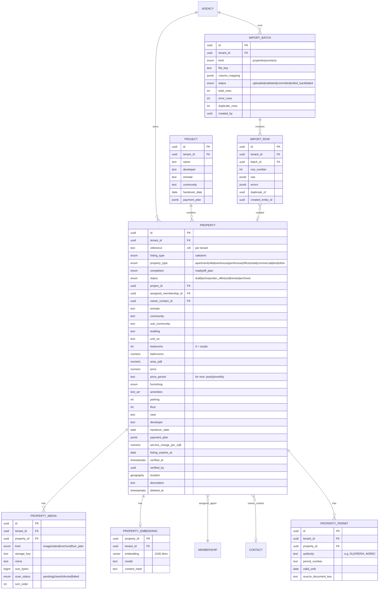
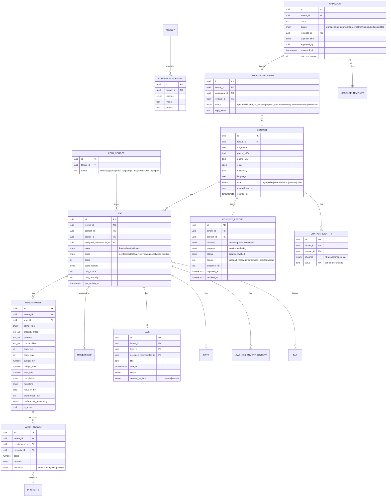
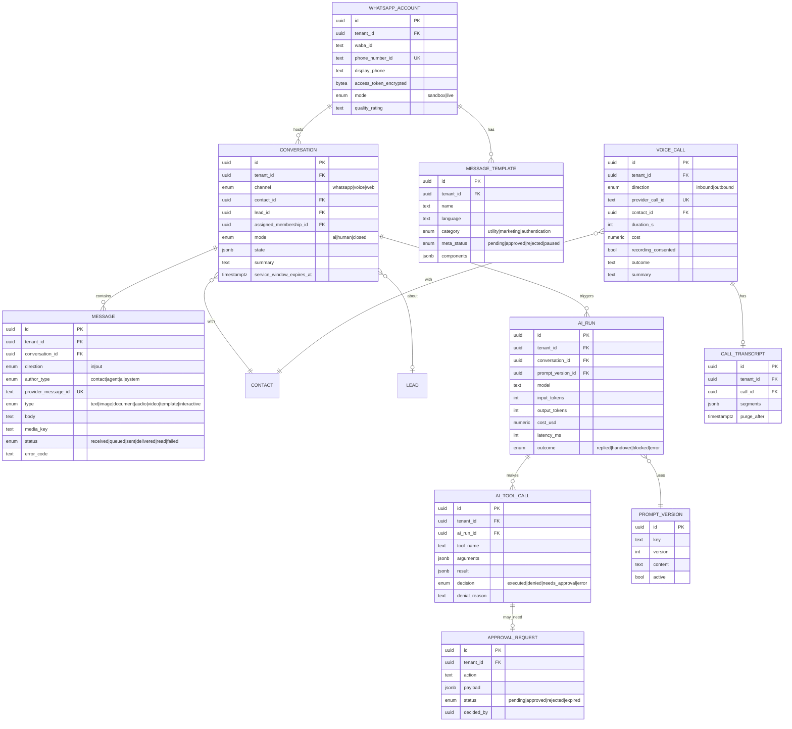
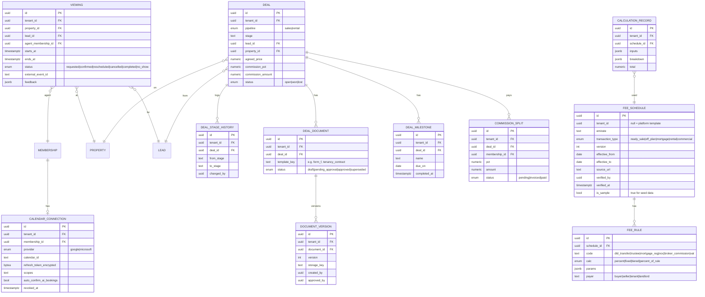

# 03 · Database ERD

**Version:** 0.1 · **Date:** 2026-11-20 · PostgreSQL 16 + pgvector · Prisma ORM

## Conventions

- Primary keys: `id uuid` (UUIDv7). Every tenant-owned table has `tenant_id uuid not null` → `agency.id`, with RLS policy `tenant_id = current_setting('app.tenant_id')::uuid`.
- Timestamps: `created_at`, `updated_at` (timestamptz). Soft delete `deleted_at` where noted.
- Money: `numeric(14,2)` plus `currency char(3)` default `AED`. Never floats.
- Phones: stored E.164 in `phone_e164`; raw input kept in `phone_raw`.
- Enum-like values use Postgres enums via Prisma.
- Platform-level tables (no `tenant_id`, no RLS for app role, accessed only by platform role): `user`, `plan`, `feature_flag`, `platform_admin`, `webhook_event` (has nullable tenant_id), `security_event`.

The diagram is split into domains for readability. The full set of tables is listed in §7.

## 1. Identity, tenancy and billing

```mermaid
erDiagram
  USER ||--o{ MEMBERSHIP : has
  AGENCY ||--o{ MEMBERSHIP : has
  AGENCY ||--o{ INVITATION : issues
  USER ||--o{ SESSION : has
  USER ||--o{ MFA_FACTOR : has
  AGENCY ||--o{ TEAM : has
  TEAM ||--o{ MEMBERSHIP : groups
  AGENCY ||--o{ AUDIT_LOG : records
  AGENCY ||--|| AGENCY_SETTINGS : has
  AGENCY ||--o| SUBSCRIPTION : has
  PLAN ||--o{ SUBSCRIPTION : defines
  AGENCY ||--o{ USAGE_RECORD : accrues
  AGENCY ||--o{ INVOICE : billed
  AGENCY ||--o{ SPENDING_CAP : sets

  USER {
    uuid id PK
    citext email UK
    text password_hash
    timestamptz email_verified_at
    text full_name
    text locale
    bool is_platform_admin
    timestamptz last_login_at
  }
  AGENCY {
    uuid id PK
    text name
    text slug UK
    text trade_license_no
    text orn "RERA ORN, optional"
    text emirate
    enum status "pending|active|suspended|cancelled"
    timestamptz onboarded_at
  }
  MEMBERSHIP {
    uuid id PK
    uuid tenant_id FK
    uuid user_id FK
    uuid team_id FK
    enum role "owner|admin|manager|agent"
    enum status "active|suspended|removed"
    text brn "broker reg no, optional"
  }
  INVITATION {
    uuid id PK
    uuid tenant_id FK
    citext email
    enum role
    text token_hash
    timestamptz expires_at
    timestamptz accepted_at
    uuid invited_by FK
  }
  SESSION {
    uuid id PK
    uuid user_id FK
    text refresh_token_hash
    text ip
    text user_agent
    timestamptz expires_at
    timestamptz revoked_at
  }
  MFA_FACTOR {
    uuid id PK
    uuid user_id FK
    enum type "totp|recovery"
    bytea secret_encrypted
    timestamptz verified_at
  }
  TEAM {
    uuid id PK
    uuid tenant_id FK
    text name
    uuid manager_membership_id FK
  }
  AUDIT_LOG {
    uuid id PK
    uuid tenant_id FK
    uuid actor_user_id
    enum actor_type "user|ai|system|platform"
    text action
    text entity_type
    uuid entity_id
    jsonb before
    jsonb after
    text ip
    timestamptz created_at
  }
  AGENCY_SETTINGS {
    uuid tenant_id PK
    jsonb branding
    jsonb ai_settings
    int listing_freshness_days
    bool outbound_voice_enabled "default false"
    jsonb retention_policy
  }
  PLAN {
    uuid id PK
    text code "starter|professional|agency|enterprise"
    int seat_limit
    jsonb included_usage
    numeric price_monthly
  }
  SUBSCRIPTION {
    uuid id PK
    uuid tenant_id FK
    uuid plan_id FK
    enum status "trialing|active|past_due|cancelled"
    text provider_customer_id
    text provider_subscription_id
    int seats
    timestamptz current_period_end
  }
  USAGE_RECORD {
    uuid id PK
    uuid tenant_id FK
    enum meter "ai_tokens|wa_conversation|voice_minute|storage_gb"
    numeric quantity
    numeric unit_cost
    text source_ref
    timestamptz occurred_at
  }
  INVOICE {
    uuid id PK
    uuid tenant_id FK
    text provider_invoice_id
    numeric amount
    numeric vat_amount
    enum status
  }
  SPENDING_CAP {
    uuid id PK
    uuid tenant_id FK
    enum meter
    numeric monthly_limit
    enum action "warn|block"
  }
```



## 2. Inventory



## 3. CRM, consent and campaigns



## 4. Conversations, AI and voice



## 5. Calendar, deals, fees



## 6. Key indexes and constraints

| Table | Index / constraint |
|---|---|
| property | `(tenant_id, status, listing_type, emirate, property_type, bedrooms, price)`; unique `(tenant_id, reference)`; GIN on `amenities`; trigram on `(building, unit_no)` for duplicate detection |
| property_embedding | HNSW `embedding vector_cosine_ops`; `(tenant_id)` |
| contact | unique partial `(tenant_id, phone_e164) where deleted_at is null and merged_into_id is null`; trigram on `full_name` |
| lead | `(tenant_id, assigned_membership_id, stage)`, `(tenant_id, last_activity_at desc)` |
| message | unique `(provider_message_id)`; `(tenant_id, conversation_id, created_at)` |
| consent_record | `(tenant_id, contact_id, channel, purpose, captured_at desc)` |
| webhook_event | unique `(provider, external_id)` |
| usage_record | `(tenant_id, meter, occurred_at)` — consider monthly partitioning |
| audit_log | `(tenant_id, created_at desc)`, `(tenant_id, entity_type, entity_id)` — monthly partitioning |

## 7. Full table list

Platform: `user`, `session`, `mfa_factor`, `plan`, `feature_flag`, `webhook_event`, `security_event`, `support_ticket`, `prompt_version`, `outbox_event`.
Tenant: `agency`, `agency_settings`, `membership`, `team`, `invitation`, `audit_log`, `subscription`, `usage_record`, `invoice`, `spending_cap`, `project`, `property`, `property_permit`, `property_media`, `property_embedding`, `import_batch`, `import_row`, `contact`, `contact_identity`, `consent_record`, `suppression_entry`, `lead_source`, `lead`, `lead_assignment_history`, `requirement`, `match_result`, `tag`, `lead_tag`, `note`, `task`, `campaign`, `campaign_recipient`, `whatsapp_account`, `message_template`, `conversation`, `message`, `ai_run`, `ai_tool_call`, `approval_request`, `voice_compliance_config`, `voice_call`, `call_transcript`, `calendar_connection`, `viewing`, `deal`, `deal_stage_history`, `deal_milestone`, `deal_document`, `document_version`, `commission_split`, `fee_schedule`, `fee_rule`, `calculation_record`, `brand_kit`, `generated_asset`, `landing_page`, `utm_visit`.

## 8. RLS policy template

```sql
ALTER TABLE property ENABLE ROW LEVEL SECURITY;
ALTER TABLE property FORCE ROW LEVEL SECURITY;

CREATE POLICY tenant_isolation ON property
  USING (tenant_id = current_setting('app.tenant_id', true)::uuid)
  WITH CHECK (tenant_id = current_setting('app.tenant_id', true)::uuid);

-- app role: no BYPASSRLS, not table owner
GRANT SELECT, INSERT, UPDATE, DELETE ON property TO propforce_app;
```

If `app.tenant_id` is unset, `current_setting(..., true)` returns NULL and the policy matches no rows (fail closed).
