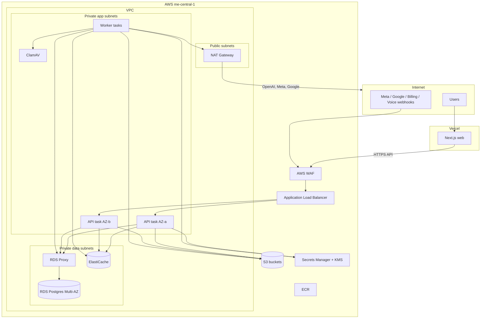
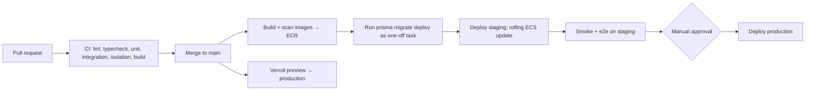

# 08 · Infrastructure Architecture

**Version:** 0.1 · **Date:** 2026-11-20

## 1. Recommendation

**Backend on AWS `me-central-1` (UAE region), frontend on Vercel.** AWS has a UAE region with managed PostgreSQL (RDS, pgvector supported), Redis-compatible cache (ElastiCache/Valkey), S3, KMS, Secrets Manager and container hosting (ECS Fargate). This keeps tenant data in the UAE, which simplifies PDPL conversations with agencies. Service availability in `me-central-1` must be confirmed per service at setup time.

Alternative for a faster, cheaper MVP: a PaaS (Render, Railway, Fly.io) plus Neon/Supabase Postgres. Simpler, but none currently guarantee UAE residency, so it is a trade-off to decide (PRD Q4).

| Concern | Choice |
|---|---|
| Frontend | Vercel (Next.js); edge caching for static assets; verify nearest region for SSR functions |
| API | ECS Fargate service, ≥ 2 tasks across 2 AZs, behind ALB + AWS WAF |
| Workers | Separate ECS service(s), autoscaled on queue depth |
| Database | RDS PostgreSQL 16, Multi-AZ (production), pgvector, PITR 7–35 days, RDS Proxy or PgBouncer for pooling |
| Cache/queues | ElastiCache (Redis/Valkey) with TLS + AUTH, Multi-AZ in production |
| Object storage | S3 with Block Public Access, SSE-KMS, lifecycle rules |
| Secrets | AWS Secrets Manager; KMS CMK for envelope encryption of tokens |
| Email | Amazon SES or Postmark/Resend (verify region/deliverability) |
| Malware scanning | ClamAV sidecar/worker container (or managed alternative) |
| Observability | OpenTelemetry → Grafana Cloud or Datadog; Sentry for errors; CloudWatch for infra |
| CI/CD | GitHub Actions with OIDC to AWS (no long-lived keys); ECR for images |
| IaC | Terraform (from staging onward) |

## 2. Environment topology

| Environment | Purpose | Sizing (start) |
|---|---|---|
| Local | docker-compose: Postgres+pgvector, Redis, MinIO, Mailpit, ClamAV; fake adapters | laptop |
| CI | Ephemeral Postgres/Redis service containers | GitHub runners |
| Staging | Production-like, single-AZ, sandbox integrations (WhatsApp test number, Google test OAuth) | small instances |
| Production | Multi-AZ, backups, WAF, alerting | see cost doc |

## 3. Network and access

- Only ALB is public; tasks and data stores in private subnets.
- Security groups: ALB → API only; API/Worker → RDS Proxy/Redis only.
- Outbound egress through NAT; consider egress allowlisting via proxy for third-party hosts.
- Admin access through SSM Session Manager; no SSH, no public DB.
- Separate AWS accounts for staging and production (AWS Organizations), least-privilege IAM roles per service.

## 4. Deployment

- Migrations are backward compatible (expand → migrate → contract) so rolling deploys are safe.
- Feature flags gate incomplete modules.
- Rollback: redeploy previous image tag; migrations designed to be forward-fixable.

## 5. Scaling plan (to be validated by load tests)

| Load | API | Workers | DB | Redis |
|---|---|---|---|---|
| 100 agencies (~1,500 users, ~5k conversations/day) | 2 × 1 vCPU/2 GB | 2–4 × 1 vCPU | db.t4g.large or m7g.large Multi-AZ | cache.t4g.small/medium |
| 1,000 agencies | 4–8 tasks autoscaled | 8–20 tasks autoscaled on queue lag | m7g.xlarge/2xlarge + read replica | cache.m7g.large cluster |

These are starting estimates. The claim "supports N agencies" will only be made after k6 load tests (`infra/k6`) reproduce the target profile: webhook bursts, inbox reads, matching queries, AI reply throughput with a mocked LLM latency.

## 6. Backup and disaster recovery

| Item | Target |
|---|---|
| RDS automated backups + PITR | 14 days (prod) |
| Daily snapshot copy to second region (e.g. eu-central-1 or me-south-1, subject to data residency review) | 30 days |
| S3 versioning + replication for media | enabled in prod |
| RPO / RTO | ≤ 15 min / ≤ 4 h (targets, test quarterly) |
| Restore drill | Quarterly, documented in runbook |

## 7. Observability

- Dashboards: API latency/error rate, queue depth/age per queue, DLQ size, AI latency/cost per tenant, WhatsApp error codes, DB CPU/connections/slow queries, Redis memory.
- Alerts: 5xx > 2% for 5 min, queue age > 2 min for inbound-messages, DLQ growth, webhook signature failure spikes, RLS violation errors, spend anomalies.
- Health endpoints: `/health/live`, `/health/ready` (DB, Redis).
